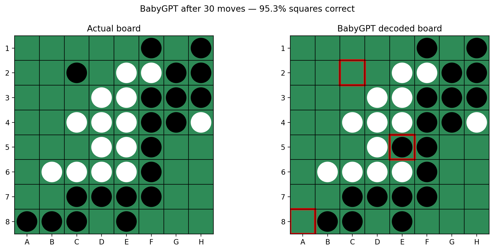
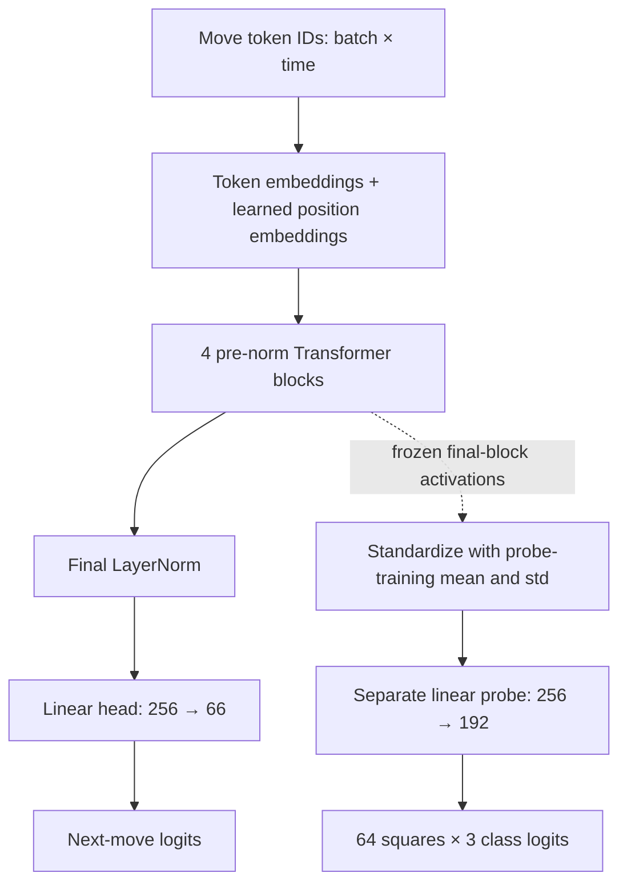

# BabyGPT Othello Player

**A 3.2M-parameter GPT trained from scratch on ~20M Othello games, exploring internal board-state representations.**

I built BabyGPT to learn how Transformers work by implementing and training one myself in PyTorch. It receives a sequence of Othello moves and predicts the next token. During pretraining, it never receives a board, board-state labels, or the rules of Othello.

The research question: **Does learning to predict moves make information about the board decodable from the model's hidden activations?**

After pretraining, I froze BabyGPT and trained a separate linear classifier to predict the state of each square from its activations. Player-relative ownership—“mine” or “my opponent's”—was substantially easier to decode than absolute black/white ownership.

This is a learning and research reproduction project inspired by [OthelloGPT](https://arxiv.org/abs/2210.13382) and [research on linear board representations](https://arxiv.org/abs/2309.00941). The results describe one pretraining trajectory and exploratory probes. They are not an independent replication across training seeds, a novel discovery, or a demonstration of competitive play.

[Results](#results) · [Architecture](#architecture) · [Run it](#run-it) · [Reproduce the evaluations](#reproduce-the-evaluations) · [Limitations](#limitations)

## A board reconstructed through a probe



**61 of 64 squares correct in this one illustrated position, after 30 moves.** Left: the board reconstructed by replaying the actual moves. Right: predictions from the separately trained linear probe applied to BabyGPT's hidden activations. The original image's “BabyGPT decoded board” title refers to this two-stage process; BabyGPT itself outputs next-move logits, not boards.

The figure uses player-relative labels: dark pieces mean the next player's pieces and light pieces mean the opponent's. After 30 turns the next player is Black, so these happen to match absolute colors. Red outlines mark errors. This is one example, not the aggregate test accuracy.

## Results

All figures below are recorded in the original notebook. Each probe predicts three classes per square, including empty. **Occupied-square accuracy** evaluates only squares that are occupied in the ground truth; an empty prediction on an occupied square counts as an error.

| Pretraining checkpoint | Player-relative occupied-square accuracy |
| --- | ---: |
| Random initialization | 45.85% |
| 1M games | 69.03% |
| 10M games | 80.86% |
| 20M label: 19,975,000 games | **83.93%** |

“Random” is an untrained Transformer with a trained linear probe, not a random-guess baseline. The three trained checkpoints come from the same trajectory.

| Labels used by the 20M probe | All-square accuracy | Occupied-square accuracy |
| --- | ---: | ---: |
| Absolute: white / empty / black | 71.79% | 54.06% |
| Player-relative: opponent / empty / mine | **88.37%** | **83.93%** |

Final recorded next-token validation cross-entropy: **2.1549**, excluding padding targets.

The occupied-square gap is **29.87 percentage points**. A useful way to understand it: the same black piece is “mine” when Black moves next and “theirs” when White moves next. Changing the labels makes information much easier for this linear classifier to recover. This observation does not establish which computations the model uses to choose a move.

### What was verified during repository preparation?

The saved 20M probe was evaluated on the supplied cached test activations: it matched **83.93%** occupied-square accuracy and **61/64** for the illustrated sample. All five final probes were also retrained from the supplied caches and matched the recorded rounded metrics. CPU checkpoint loading, numerical equivalence to the notebook model, and the smoke tests passed. See [REPRODUCIBILITY.md](REPRODUCIBILITY.md) for the complete verification record and boundaries.

## Architecture



Each block applies LayerNorm → causal multi-head attention → residual addition, then LayerNorm → a two-layer GELU MLP → residual addition. The implementation retains my PyTorch modules and parameter names. It uses PyTorch's scaled dot-product attention, as in the final notebook implementation; no Hugging Face Transformers model is used.

| Setting | Value |
| --- | --- |
| Trainable model parameters | 3,208,770 |
| Transformer blocks | 4 |
| Embedding width | 256 |
| Attention heads | 4, each of width 64 |
| MLP hidden width | 1,024 |
| Context length | 60 tokens |
| Vocabulary | 66: PAD = 0, squares = 1–64, PASS = 65 |
| Position embeddings | Learned |
| Dropout | None |
| Linear biases | Enabled, including Q/K/V and output head |
| Token embeddings and output head | Separate, untied weights |

## Data and training

The source is the Classic subset of the public [MetaOthello dataset](https://huggingface.co/datasets/aviralchawla/metaothello), `train_classic_20M.zarr`. Only its `seqs` move sequences are used for pretraining. Square tokens are row-major: 1 = A1, 8 = H1, 9 = A2, …, 64 = H8.

The notebook downloaded 1,600 consecutive chunks of 12,500 sequences each:

| Purpose | Chunk IDs | Games |
| --- | --- | ---: |
| Pretraining validation | 0000 | 12,500 |
| Pretraining test | 0001 | 12,500 |
| Training | 0002–1599 | 19,975,000 |

Training makes one pass through the training chunks in order. Within chunk `i`, games are shuffled with NumPy seed `42 + i`. Model initialization uses PyTorch seed 42. The input is `game[:-1]`; the target is `game[1:]`, giving 59 next-token positions per sequence before padding is excluded. There is no beginning-of-game token or first-move prediction target.

The optimizer is AdamW with learning rate `3e-4`, weight decay `0.01`, default betas `(0.9, 0.999)`, and batch size 256. The original run used CUDA BF16 autocast. There is no learning-rate schedule or gradient clipping. Validation sums cross-entropy over non-padding targets and divides by their count. The “20M” checkpoint name rounds the actual training count.

### How the probes work

Probing is a second supervised task. Board labels are obtained by replaying games with the Othello rules; they are never fed into GPT pretraining. The Transformer stays frozen.

| Probe split | Source and Python slice | Games |
| --- | --- | ---: |
| Train | `classic_0002.npy[100:1100]` | 1,000 |
| Validation | `classic_0000.npy[:250]` | 250 |
| Test | `classic_0001.npy[100:600]` | 500 |

For each game, cached features correspond to the board **after** history lengths `5, 10, 15, 20, 25, 30, 35, 40, 45, 50, 55, 59`. The cache contains all four blocks; reported probes use block 4's output **before** the final LayerNorm. A position after `p` turns maps to activation index `p - 1`.

The classifier is a single `Linear(256, 64 * 3)`, trained for 150 full-batch epochs with AdamW (`lr=0.001`, `weight_decay=0.01`, seed 42). Features are standardized using only the probe-training mean and sample standard deviation. Weights are selected by the lowest validation cross-entropy, then evaluated on the test split. There are 6,000 test positions, with multiple correlated positions from each of 500 games.

The replay code uses black = `+1`, white = `-1`, empty = `0`. Absolute labels are `board + 1`. Player-relative labels are `board * next_player + 1`, where `next_player = (-1)**p`. Passes count as turns; padding does not. The code replays `seqs` and does not consume the dataset's separately stored board-state arrays or their color-sign convention.

## Run it

Use Python 3.10 or newer. From the repository directory:

```bash
python -m venv .venv
source .venv/bin/activate
python -m pip install -r requirements.txt
python -m unittest discover -s tests -v
```

For a CPU-only PyTorch installation, install PyTorch from its CPU index first:

```bash
python -m pip install 'torch>=2.6,<3' --index-url https://download.pytorch.org/whl/cpu
python -m pip install -r requirements.txt
```

**[Download the checkpoints and read the model card on Hugging Face](https://huggingface.co/jiviteshhp/BabyGPT-Othello).** To download the final checkpoint into the expected local directory:

```bash
python -m pip install huggingface_hub
hf download jiviteshhp/BabyGPT-Othello babygpt_20M.pt --local-dir babygpt_checkpoints
```

With a local copy of `babygpt_20M.pt`, inspect next-move probabilities on CPU:

```bash
python evaluate.py predict --checkpoint babygpt_checkpoints/babygpt_20M.pt \
  --moves 45 44 27 46 51 --device cpu
```

Predictions are unfiltered model probabilities, not a legal-move mask or a game-playing engine. Input histories are checked by the replay code. You can also load the model directly:

```python
import torch
from model import load_model

model = load_model("babygpt_checkpoints/babygpt_20M.pt", device="cpu")
with torch.no_grad():
    logits = model(torch.tensor([[45, 44, 27, 46, 51]]))
print(logits.shape)  # (1, 5, 66)
```

The original [notebook](notebooks/BabyGPT.ipynb) is retained byte-for-byte as a record of my learning process, including earlier experiments and outputs. It is not the recommended entry point for a new full run. To explore it interactively, install `jupyterlab`, `matplotlib`, and `requirements-data.txt`; historical cells assume CUDA and notebook execution state.

## Reproduce the evaluations

### Prepare the data and train

Downloading all 20M move sequences stores about 1.2 GB of raw token arrays, excluding cache overhead. The downloader requests only `seqs`.

```bash
python -m pip install -r requirements-data.txt
python data.py --output-dir babygpt_data
python train.py --data-dir babygpt_data --output-dir runs/pretraining \
  --device cuda --precision bf16
```

For evaluation and probing with existing weights, only the first three chunks are needed:

```bash
python data.py --output-dir babygpt_data --chunks 3
```

All paths are configurable. Use `--source` for a local Zarr store. Resume explicitly with `--resume path/to/latest.pt` and a new, empty `--output-dir`. `--end-chunk 3` limits training to chunk 0002. CPU training is supported with `--device cpu --precision fp32`, but a full run is substantial and need not reproduce GPU numerics exactly.

### Next-token validation loss

```bash
python evaluate.py loss --checkpoint babygpt_checkpoints/babygpt_20M.pt \
  --games babygpt_data/classic_0000.npy --device cpu --precision fp32
```

Use `--device cuda --precision bf16` to match the original validation precision. CPU FP32 is useful for checking behavior but may differ slightly from the recorded 2.1549. Use chunk 0001 for test cross-entropy; no test cross-entropy result is claimed here.

### Extract features and train the probes

```bash
python probe.py extract --data-dir babygpt_data \
  --checkpoint-dir babygpt_checkpoints --output-dir runs/features --device cpu

for model in Random 1M 10M 20M; do
  python probe.py fit --features-dir runs/features --model "$model" \
    --labels relative --output "runs/probes/${model}_relative.pt"
done

python probe.py fit --features-dir runs/features --model 20M \
  --labels absolute --output runs/probes/20M_absolute.pt
```

Feature extraction can also run on CUDA; it uses FP32. Use `--models 20M` to extract only that checkpoint. Each `fit` reports aggregate test metrics after selecting weights on validation data. Existing outputs are protected: choose a new output path for a new run.

If you already have the original `babygpt_features/` cache, point `--features-dir` there to rerun just the probe experiments. For the original saved probe and image sample:

```bash
python probe.py score --features-dir babygpt_features --model 20M \
  --labels relative --probe babygpt_features/probe_20M_relative.pt --sample-index 5
```

For a probe trained by the commands above, substitute `runs/features` and `runs/probes/20M_relative.pt`. `--sample-index 5` selects probe-test game 0 after 30 moves. The reported sample count can be checked without regenerating or altering the original image.

## Repository guide

```text
BabyGPT-Othello-Player/
├── README.md
├── REPRODUCIBILITY.md
├── artifacts.sha256          # Checksums; the large artifacts remain local
├── model.py                  # Original PyTorch Transformer
├── train.py                  # Chunked next-token training
├── evaluate.py               # Cross-entropy and next-move probabilities
├── probe.py                  # Frozen features, probe training and scoring
├── othello.py                # Rules, replay and label conventions
├── data.py                   # Download and validate move-sequence chunks
├── requirements.txt
├── requirements-data.txt
├── .gitignore
├── tests/test_smoke.py
├── notebooks/BabyGPT.ipynb    # Original notebook, unchanged
└── assets/board_comparison.png
```

Datasets, checkpoints, activation arrays, saved probes, and run outputs are ignored by Git. The small board visualization is included. Trained weights are hosted on [Hugging Face](https://huggingface.co/jiviteshhp/BabyGPT-Othello); [MODEL_CARD.md](MODEL_CARD.md) is the source of the Hub model card.

## Limitations

- One pretraining trajectory; no independent training-seed replication, confidence intervals, or hyperparameter sweep.
- This is a small educational reproduction of ideas from existing research, with different architecture and experimental details. Results are not directly comparable to the original papers' benchmarks.
- Linear decodability does not establish causal use of the decoded board state. No intervention experiments are reported here.
- Probe training games were also seen during model pretraining. Probe validation and test games come from chunks held out of pretraining, but cross-chunk duplicate sequences were not audited in the final pipeline. An earlier notebook deduplication experiment was not used for the final run.
- Exploratory notebook experiments reused held-out games. These results should not be treated as a preregistered, untouched benchmark.
- Empty squares affect overall accuracy; occupied-square accuracy is the more informative ownership metric here. The illustrative board's 95.3% is not a dataset-wide result.
- No Elo, win-rate, search-based play, or competitive-strength evaluation is provided.
- The original environment and dataset revision were not pinned. The full pretraining run, raw-data feature extraction, and full validation cross-entropy have not been rerun during repository preparation.

## References

1. Kenneth Li et al. **Emergent World Representations: Exploring a Sequence Model Trained on a Synthetic Task** (ICLR 2023). [Paper](https://arxiv.org/abs/2210.13382) · [OthelloGPT code](https://github.com/likenneth/othello_world).
2. Neel Nanda, Andrew Lee, and Martin Wattenberg. **Emergent Linear Representations in World Models of Self-Supervised Sequence Models** (2023). [Paper](https://arxiv.org/abs/2309.00941).
3. Aviral Chawla, Galen Hall, and Juniper Lovato. **MetaOthello: A Controlled Study of Multiple World Models in Transformers** (2026). [Paper](https://arxiv.org/abs/2602.23164) · [Dataset](https://huggingface.co/datasets/aviralchawla/metaothello) · [Code](https://github.com/aviralchawla/metaothello).
